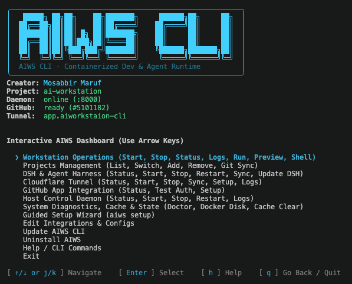

<p align="center">
  
</p>

<h1 align="center">AIWS — AI Workstation CLI</h1>

<p align="center">
  <strong>A secure, container-isolated development environment for remote Linux VPS, featuring DeepSeek Harness agent workflows, brokered GitHub authentication, and host control tooling.</strong>
  <br />
  <em>Companion Web Interface: <a href="https://github.com/mosabbir-maruf/aiws">AIWS Web Dashboard</a></em>
</p>

<p align="center">
  <a href="https://github.com/mosabbir-maruf/ai-workstation-cli/actions/workflows/image.yml"></a>
  <a href="https://github.com/mosabbir-maruf/ai-workstation-cli/pkgs/container/aiws-cli"></a>
  <a href="https://github.com/mosabbir-maruf/ai-workstation-cli"></a>
  <a href="https://www.docker.com/"></a>
  <a href="https://github.com/deepseek-ai/deepseek-harness"></a>
  <a href="LICENSE"></a>
  <a href="SECURITY.md"></a>
</p>

<p align="center">
  
</p>

---

## Table of Contents

1. [Overview & Architecture](#1-overview--architecture)
2. [Prerequisites & Supported Platforms](#2-prerequisites--supported-platforms)
3. [Quick Start](#3-quick-start)
4. [Configuration Reference](#4-configuration-reference)
5. [Everyday Usage](#5-everyday-usage)
6. [Service Management](#6-service-management)
7. [Backup, Recovery & Updates](#7-backup-recovery--updates)
8. [Troubleshooting](#8-troubleshooting)
9. [Security Model & Trust Boundaries](#9-security-model--trust-boundaries)
10. [Development & Verification](#10-development--verification)
11. [Uninstallation & References](#11-uninstallation--references)

---

## 1. Overview & Architecture

AIWS provides one unified, reproducible development environment on a remote server. Instead of configuring tools and agents directly on the host, development projects run inside an isolated Docker container, while project files, agent history, and credentials persist safely on the host.

### Core Capabilities

- **One Container, Many Projects:** Code repositories live under `~/projects/` on the host. Only the active project is mounted into the container at `/workspace`.
- **Persistent AI Agent Runtime:** DeepSeek Harness (`@deepseek-ai/dsh`) session memory and provider keys persist in `runtime/dsh/` across container restarts and image upgrades.
- **Brokered GitHub Credentials:** A host-side broker issues short-lived installation tokens over a local Unix domain socket. Long-lived personal access tokens (PATs) and host SSH keys are never mounted into containers.
- **Host Control Daemon:** An asynchronous control bridge (`daemon/server.py` on `127.0.0.1:8000`) provides authenticated REST and SSE endpoints for the companion web dashboard.
- **Interactive Terminal UI:** Run `aiws` to launch a full-screen, keyboard-navigable terminal dashboard.

### Architecture Flow

```text
Operator / Browser
       │
       │ SSH Port Forwarding / Cloudflare Tunnel
       ▼
Host Management Layer (Ubuntu VPS)
  ├── Host CLI (`aiws`)
  ├── Control Daemon (`daemon/server.py:8000`, requires Bearer auth)
  ├── GitHub Broker Service (`ai-github-broker.service`)
  ├── Secrets (`.env`, `secrets/github-app.pem` — mode 0600)
  ├── Persistent Projects (`~/projects/*`)
  └── Persistent Agent State (`runtime/dsh/` — mode 0700)
        │
        │ Docker Compose (non-root, cap_drop: ALL, 512M RAM)
        ▼
Workstation Container
  ├── User: sandbox (UID 1001)
  ├── Mounted Workspace: `/workspace` (Active project only)
  ├── DeepSeek Harness (DSH on 4090, Bridge on 4091)
  ├── App Dev Server (ports 3000, 3001, 5173, 8080 on 127.0.0.1)
  └── Credential Helper (`/run/ai-github-broker/github.sock` read-only mount)
```

---

## 2. Prerequisites & Supported Platforms

### Supported Platforms

| Platform | Support Tier | Verification Status | Notes |
|---|---|---|---|
| **Ubuntu 24.04 / 22.04 LTS** | Tier 1 (Target Host) | Runtime verification pending | Recommended distribution for systemd services, Docker, and apt. |
| **Debian 12 (Bookworm)** | Tier 1 (Compatible) | Runtime verification pending | Supported base for systemd units and packages. |
| **macOS (Darwin arm64 / x86_64)** | Development / Testing | Behaviorally verified | Full support for CLI commands, Docker builds, and automated unit tests. Host systemd units require Linux. |

### Software Prerequisites

Ensure the following tools are installed before setup:

- **Docker Engine:** `24.0+` (`docker --version`)
- **Docker Compose Plugin:** `v2.20+` (`docker compose version`)
- **Python:** `3.8+` with `venv` and `ensurepip` (`python3 --version`)
- **Git:** `2.30+` (`git --version`)
- **Bash:** `3.2+` (Bash 4+ recommended on Linux)
- **OpenSSL:** For generating cryptographic tokens (`openssl version`)
- **curl:** For testing HTTP endpoints and health checks

---

## 3. Quick Start

Follow these steps in sequence on a clean host to get AIWS running:

### Step 1: Clone the Repository

```bash
git clone https://github.com/mosabbir-maruf/ai-workstation-cli.git ~/aiws-cli
cd ~/aiws-cli
```

### Step 2: Initialize Configuration and Generate API Key

Copy the environment template and generate a 32-byte hexadecimal API key for the host control daemon:

```bash
cp .env.example .env
chmod 600 .env

# Generate mandatory daemon authentication key
KEY=$(openssl rand -hex 32)
sed -i.bak "s|^WORKSTATION_API_KEY=.*|WORKSTATION_API_KEY=${KEY}|" .env && rm -f .env.bak
```

### Step 3: Run the Host Installer

Run `install.sh` to initialize the Python virtual environment, configure file permissions, register the `/usr/local/bin/aiws` symlink, and configure systemd units:

```bash
./install.sh
```

### Step 4: Start the Workstation Container

```bash
aiws start
```

### Step 5: Verify Health and Service Status

Verify that the CLI, daemon, and workstation container are healthy:

```bash
# 1. Inspect unified system status
aiws status

# 2. Run diagnostic doctor probe
aiws doctor

# 3. Query daemon HTTP health endpoint on loopback
API_KEY=$(grep '^WORKSTATION_API_KEY=' .env | cut -d= -f2)
curl -fsS -H "Authorization: Bearer $API_KEY" http://127.0.0.1:8000/api/health
```

*Expected response:* `{"ok": true, "output": "Host workstation daemon active."}`

---

## 4. Configuration Reference

All settings are stored in `.env` at the repository root. This file contains secrets and **must maintain mode `0600`**.

| Variable | Required? | Default / Example | Purpose | Security Precautions |
|---|---|---|---|---|
| `WORKSTATION_API_KEY` | **Yes** | `$(openssl rand -hex 32)` | Master Bearer credential for the daemon (`server.py`) and frontend proxy. | Mode `0600`. The daemon will refuse to start if this variable is missing or empty. |
| `AIWS_INSECURE_LOCAL` | Optional | `0` (or unset) | Set to `1` only to allow running the daemon without an API key during offline development. | **Never enable in production.** Exposes arbitrary host command execution. |
| `IMAGE` | Optional | `ghcr.io/mosabbir-maruf/aiws-cli:latest` | Workstation container image tag. | Pin to commit digest (`@sha256:...`) in high-assurance environments. |
| `DSH_VERSION` | Optional | `0.1.2-rc.1` | Pinned npm package version for DeepSeek Harness (`@deepseek-ai/dsh`). | Updates can be applied via `aiws dsh update <version>`. |
| `ACTIVE_PROJECT` | Managed | `my-app` | Identifier of the active project repository under `~/projects/`. | Managed automatically by `aiws use <project>`. |
| `ACTIVE_PROJECT_PATH` | Managed | `/home/<user>/projects/my-app` | Host path mounted to `/workspace` inside the container. | Auto-updated on project switch. |
| `WORKSTATION_DAEMON_HOST`| Optional | `127.0.0.1` | Network bind address for host control daemon. | Keep bound strictly to loopback (`127.0.0.1`). |
| `WORKSTATION_DAEMON_PORT`| Optional | `8000` | TCP port for daemon HTTP/SSE listener. | Ensure no host port conflict. |
| `GITHUB_APP_ID` | Optional | `123456` | GitHub App ID for brokered Git authentication. | Configured via `aiws github setup`. |
| `GITHUB_INSTALLATION_ID` | Optional | `7891011` | GitHub App Installation ID. | Configured via `aiws github setup`. |
| `ALLOWED_HOSTS` | Optional | `""` | Hostname allowlist for Vite/Next dev servers. | Populated by `aiws tunnel setup`. |
| `CLOUDFLARED_APP_HOSTNAME`| Optional | `app.example.com` | Public tunnel hostname for the active development server. | Set during Cloudflare tunnel setup. |
| `CLOUDFLARED_DSH_HOSTNAME`| Optional | `dsh.example.com` | Public tunnel hostname for DeepSeek Harness bridge. | Set during Cloudflare tunnel setup. |

To edit settings safely with automatic syntax verification:

```bash
aiws config
```

---

## 5. Everyday Usage

### Interactive Terminal UI (TUI)

Launch the interactive dashboard at any time:

```bash
aiws
```

Use arrow keys or numbers to manage projects, start/stop services, stream logs, pull/push Git changes, or inspect ports. Press `q` to return or exit.

### Core CLI Commands

#### Project Management
```bash
aiws add https://github.com/org/my-project.git   # Clone repository to ~/projects/
aiws list                                          # List local repositories
aiws use my-project                                # Mount project to /workspace
aiws remove my-project                             # Delete project checkout
```

#### Workstation & App Runtime
```bash
aiws start                  # Boot Docker Compose workstation container
aiws stop                   # Halt workstation container
aiws restart                # Restart container
aiws status                 # Display unified service status
aiws shell                  # Open bash prompt as sandbox user in /workspace
aiws run                    # Auto-detect framework and launch dev server
aiws app status             # Inspect application process state
aiws app logs               # Stream live application dev server logs
aiws app restart            # Restart application process
aiws app stop               # Terminate application process
```

#### Git Operations with Secret Guardrails
```bash
aiws diff                   # Show working tree changes
aiws pull                   # Fast-forward pull from upstream origin
aiws push "feat: add auth"  # Verify no secrets staged, commit, and push
```
*`aiws push` scans staged files before committing and aborts immediately if sensitive patterns (`.env`, `*.pem`, `*.key`, `credentials.json`) are detected.*

#### Ingress & Port Forwarding
```bash
aiws preview                # Detect active container ports and generate SSH tunnel command
```
Example SSH forward command for your local machine:
```bash
ssh -N -L 3000:127.0.0.1:3000 -L 5173:127.0.0.1:5173 user@your-vps-ip
```

#### DeepSeek Harness (DSH) Agent Engine
```bash
aiws harness status         # Inspect DSH (4090) and Bridge (4091) processes
aiws harness restart        # Restart DSH and bridge supervisor
aiws dsh version            # Show installed @deepseek-ai/dsh package version
aiws dsh update 0.1.2-rc.1  # Update or reinstall DSH agent package
```

#### GitHub App Broker
```bash
aiws github setup <app_id> <inst_id> /path/to/key.pem   # Configure credentials
aiws github test                                        # Test token generation
```
For complete GitHub App creation steps, see [docs/github-app-setup.md](docs/github-app-setup.md).

#### Cloudflare Zero Trust Tunnel
```bash
aiws tunnel setup           # Configure tunnel connector and hostnames
aiws tunnel status          # Inspect connection status
aiws tunnel sync 3000       # Update target application port
```
For Cloudflare DNS configuration, see [docs/cloudflare-tunnel.md](docs/cloudflare-tunnel.md).

---

## 6. Service Management

AIWS runs two host-level background services on Linux:

- **`aiws-daemon.service`:** Host control daemon on `127.0.0.1:8000`.
- **`ai-github-broker.service`:** GitHub App token broker socket on `runtime/github-broker/github.sock`.

### Common Service Commands

```bash
# Check service status
systemctl status aiws-daemon ai-github-broker

# Restart services
sudo systemctl restart aiws-daemon
sudo systemctl restart ai-github-broker

# View live systemd logs
journalctl -u aiws-daemon -f
journalctl -u ai-github-broker -f
```

---

## 7. Backup, Recovery & Updates

### Exporting State Snapshots

```bash
aiws state export
```

Creates an archive at `~/aiws-state-backups/aiws-state-<timestamp>.tar.gz` containing your `.env` configuration and `runtime/dsh/` agent history.

### Importing State with Automatic Rollback

```bash
aiws state import ~/aiws-state-backups/aiws-state-<timestamp>.tar.gz
```

**Rollback Guarantee:** AIWS verifies archive structure, checks for traversal elements (`../`), and stages files before touching live state. If extraction or replacement fails, your previous `.env` and `runtime/dsh/` are restored automatically.

### Cache Pruning

```bash
aiws cache prune
```

Cleans Docker build caches, dangling layers, and temporary logs without modifying project checkouts or agent state.

### Updating AIWS

```bash
./update.sh
```

Pulls the latest verified Git commits, verifies dependencies, and restarts daemon services cleanly.

---

## 8. Troubleshooting

| Symptom | Likely Cause | Diagnostic Command | Corrective Action | When to Stop & Escalate |
|---|---|---|---|---|
| Daemon exits with `ERROR: WORKSTATION_API_KEY is not configured` (exit 1). | Missing or empty API key in `.env`. | `grep "^WORKSTATION_API_KEY=" .env` | Run `KEY=$(openssl rand -hex 32) && echo "WORKSTATION_API_KEY=$KEY" >> .env`. | If file exists but daemon fails to read, check file permissions (`chmod 600 .env`). |
| API calls to `127.0.0.1:8000` return `401 Unauthorized`. | Missing or mismatched Bearer token. | Inspect request headers; compare against `.env`. | Send `Authorization: Bearer <key>`. Query string tokens (`?token=`) are rejected. | Do not disable authentication in production. |
| Port conflict on `8000`, `3000`, `5173`, or `4090`. | Competing process bound to target port. | `sudo lsof -nP -iTCP:<port> -sTCP:LISTEN` | Stop competing process or run `docker compose -f docker/compose.yml down`. | Never kill unknown host processes with `kill -9` without confirming PID ownership. |
| Git commands fail with `fatal: could not read Username`. | GitHub broker socket missing or service stopped. | `ls -la runtime/github-broker/github.sock` | Start broker: `sudo systemctl restart ai-github-broker` or run `aiws github test`. | If private key is missing (`secrets/github-app.pem`), re-run `aiws github setup`. |
| `aiws state import` fails with `State archive contains unsafe or unexpected files`. | Archive contains path traversal (`../`) or unexpected files. | `tar -tzf <archive>` | Ensure archive was created via `aiws state export`. Rollback preserves prior state automatically. | Verify archive structure matches `manifest`, `.env`, and `dsh/*`. |
| Container fails to start (`Error response from daemon`). | Docker stopped, corrupted mount path, or RAM exhausted. | `systemctl status docker` and `docker compose -f docker/compose.yml config` | Ensure Docker is active. Run `docker compose -f docker/compose.yml down -v` and retry `aiws start`. | If Docker daemon crashes repeatedly, inspect disk space (`df -h`) and `journalctl -u docker`. |
| Dev server runs but browser shows `Invalid Host Header`. | Dev server rejects incoming tunnel hostname. | `echo $ALLOWED_HOSTS` | Add tunnel hostname to `ALLOWED_HOSTS` in `.env`: `ALLOWED_HOSTS=app.example.com`. | Do not set `ALLOWED_HOSTS=*` on sensitive production origins. |

---

## 9. Security Model & Trust Boundaries

### Container Hardening Controls

The workstation container runs untrusted dependencies (e.g., `npm install`, project dev servers, agent scripts):

- **Non-Root Execution:** Runs strictly as user `sandbox` (UID `1001`, GID `1001`).
- **Dropped Capabilities:** `cap_drop: [ALL]`. No Linux capabilities are retained.
- **No Privilege Escalation:** `security_opt: [no-new-privileges:true]`. Prevents `setuid` binaries from gaining elevated privileges.
- **Resource Constraints:** Hard limit of 512 MB memory, 1.5 CPUs, and 256 PIDs to mitigate fork bombs.
- **Secure `/tmp`:** Mounted as a `tmpfs` with `rw,noexec,nosuid,size=128m`.
- **No Host Docker Socket or SSH Keys:** Neither `/var/run/docker.sock` nor `~/.ssh` is ever mounted into the container.
- **Socket Directory Mounted Read-Only:** The broker directory `/run/ai-github-broker` is mounted `:ro` so the container cannot delete, overwrite, or tamper with socket files.

### Known Trust Boundaries & Operator Responsibilities

1. **Active Project Script Access (Important Known Boundary):**
   - The container mounts the broker socket so that in-container Git can clone and push code. Any process running inside the container can connect to `/run/ai-github-broker/github.sock` and request temporary installation tokens for repositories granted to the GitHub App.
   - The container also mounts `runtime/dsh` for agent workflows. Dependencies in `/workspace` running as user `sandbox` can read files in `~/.dsh` (including model API keys).
   - **Operator Action:** Only clone and execute repositories whose dependency trees you trust. Scope GitHub App installation permissions strictly to necessary repositories.
2. **Daemon Access and Network Binding:**
   - The control daemon listener binds to `127.0.0.1:8000`. **Never rebind to `0.0.0.0`**.
   - Sudo password transport over HTTP is rejected with `403 Forbidden`.
   - Host commands run in isolated process groups (`start_new_session=True`). On timeout, the entire process group is terminated with `os.killpg`.
3. **SSRF & DNS Rebinding Protection:**
   - In model discovery, target URLs are resolved and validated to block link-local (`169.254.0.0/16`), cloud metadata (`metadata.google.internal`), multicast, reserved, and private LAN ranges.
   - The client pins the socket connection directly to the validated IP to eliminate DNS rebinding, and automatic HTTP redirects are disabled. Local loopback (`127.0.0.1`, `::1`) is preserved for local model runtimes.
4. **File Permissions Checklist:**
   ```text
   chmod 600 .env
   chmod 700 secrets/
   chmod 600 secrets/github-app.pem
   chmod 700 runtime/
   chmod 700 runtime/dsh/
   chmod 600 runtime/dsh/ui-providers.json
   ```

Consult [SECURITY.md](SECURITY.md) for full threat modeling and coordinated disclosure details.

---

## 10. Development & Verification

### Running Automated Test Suites

Verify backend components locally:

```bash
# 1. Run Python unit & integration tests (21 tests covering auth, limits, SSRF, state transfer, SSE)
python3 -m unittest discover tests

# 2. Validate Python syntax across daemons and brokers
python3 -m py_compile daemon/server.py broker/github_broker.py scripts/github-app-credential-helper

# 3. Validate Bash script syntax across all CLI scripts
bash -n install.sh update.sh uninstall.sh scripts/aiws scripts/lib/*.sh docker/*.sh

# 4. Verify Docker Compose configuration
docker compose -f docker/compose.yml config --quiet
```

### API Contract Specification

The host control daemon implements a canonical OpenAPI 3.1 contract vendored at [`contracts/openapi.yaml`](contracts/openapi.yaml). It defines exact route methods, request/response schemas, body size limits, and standard error formats consumed by the companion web console.

---

## 11. Uninstallation & References

### Clean Uninstallation

To permanently remove background services, Docker containers, global CLI symlinks, and runtime directories:

```bash
aiws uninstall
```

*(Alternatively, run `./uninstall.sh`).*

Your cloned project repositories in `~/projects/` will **not** be deleted. To delete them manually, run `rm -rf ~/projects`.

### Useful References

- [SECURITY.md](SECURITY.md) — Threat model, security boundaries, and vulnerability disclosure policy.
- [CONTRIBUTING.md](CONTRIBUTING.md) — Coding conventions, shell guidelines, and PR requirements.
- [contracts/openapi.yaml](contracts/openapi.yaml) — Canonical OpenAPI 3.1 daemon API contract.
- [docs/github-app-setup.md](docs/github-app-setup.md) — Detailed GitHub App configuration walkthrough.
- [docs/cloudflare-tunnel.md](docs/cloudflare-tunnel.md) — Remote ingress setup with Cloudflare Zero Trust.
- [LICENSE](LICENSE) — MIT License.

---

**Maintainer:** Developed and maintained by [**Mosabbir Maruf**](https://github.com/mosabbir-maruf).
